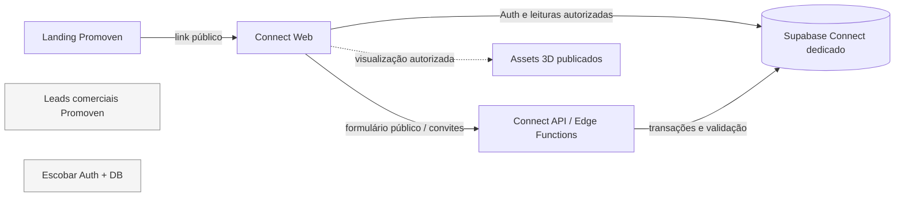

# Promoven Connect — PC-00: auditoria e arquitetura

Estado: proposta, sem implementação. Auditoria local em 22/10/2026. O repositório estava limpo antes desta documentação, no branch `master`, commit `fc3f571`, raiz `/home/rafa/RenderCasa/xixova_atelier_v4`. Isto descreve os arquivos locais; não comprova o estado dos serviços remotos.

## O que existe

| Componente | Evidência | Classificação | Decisão |
| --- | --- | --- | --- |
| Landing, demo, Auth e portal Escobar em React 19.3/Vite 8.2/React Router 7 | `xixova/maquette_web/package.json`, `src/main.tsx` | REUSE (padrões e UI), ISOLATE (runtime de dados) | Manter as rotas atuais; criar app Connect separado no mesmo monorepo. |
| Portal Escobar de organizações, projetos, inventário, CSV e auditoria | `xixova/maquette_web/src/portal/`, `src/domain/`, `src/infrastructure/` | REUSE (ideias/partes sem dependência de dados), ISOLATE (portal e Supabase) | Não conectar Connect a `/portal/*` nem ao cliente Supabase atual. |
| Viewer Three.js 0.186, GLB, seleção de unidade e descarte de recursos | `src/building/BuildingScene.tsx`, `BuildingApp.tsx`, `src/marketing/InteractiveInteriorPreview.tsx` | EXTEND | Extrair adaptadores puros apenas após contrato de assets e autorização; carregar sob demanda. |
| `xixova/director_web` React/Vite/Three | `package.json`, `src/main.tsx` | OUT OF SCOPE | Ferramenta de direção de cenas, não portal comercial. Dependências `latest` tornam a versão instalada dependente do lockfile. |
| Banco Escobar: organizações, membros, projetos, unidades, importações, convites administrativos, auditoria | `supabase/migrations/`, `supabase/seed.sql` | ISOLATE | Não aplicar migrações Connect nem compartilhar Auth, Storage ou RLS. |
| Leads comerciais da landing | `infra/promoven-leads/supabase/` e `src/marketing/remoteLead.ts` | ISOLATE | Endpoint, base e propósito próprios; não armazenar leads de compradores aqui. |
| Portal privado de corretores, links atribuídos e leads de compradores | ausência nas rotas e migrações atuais | BUILD | Implementar por checkpoints PC-01–PC-06. |
| Site público `promoven.online` | código da landing e configuração de publicação | REUSE | Continuar como entrada de marca e demonstração. Estado remoto não verificado. |

Versões declaradas da aplicação principal: React/React DOM `19.3.0`, Vite `8.2.2`, TypeScript `6.0.3`, Supabase JS `2.109.0`, Three `0.186.0`, React Router `^7.18.3`. O Diretor usa versões `latest` no manifesto; não assumir uma versão estável sem inspecionar o lockfile durante trabalho naquele app.

## Rotas atuais e limite de integração

```text
maquette_web (atual)                 Connect (proposto)
/                                  https://connect.promoven.online/
/demo                              /connect/*  organização
/demo/house-garden                 /connect/broker/*  corretor
/privacidade                       /p/*, /s/*  catálogo público
/login, /forgot-password,
 /reset-password, /accept-invitation
/portal/*  Escobar
```

`src/main.tsx` usa `BrowserRouter`, lazy load para demo/portal/área Auth e fallback SPA. `PortalApp.tsx` contém dashboard, clientes, usuários, projetos, estrutura, edifícios, tipos, unidades, importações, inventário e histórico; o próprio shell se apresenta como Escobar. `/demo/house-garden` contém uma demonstração de audiência “corretor”, não autenticação, autorização ou atribuição real. `BuildingApp.tsx` cria links de WhatsApp para `/demo` sem token de corretor. Não há rotas Connect no código atual.

### Estrutura recomendada

```text
xixova/maquette_web/                 landing, demos e portal Escobar preservados
apps/promoven-connect-web/           SPA React/Vite independente, UI e contratos
packages/connect-contracts/          tipos e validação compartilháveis com API
infra/promoven-connect/              config e migrações Supabase EXCLUSIVAS
  supabase/migrations/
  supabase/tests/database/
  supabase/functions/                endpoints públicos e operações privilegiadas
docs/PROMOVEN_CONNECT_*.md           decisões e critérios desta série
```

Criar estes diretórios somente a partir de PC-01. O app Connect recebe apenas `VITE_CONNECT_SUPABASE_URL` e publishable key próprias. O servidor usa segredo privado apenas no ambiente Connect. A landing pode apontar para o host Connect depois de aprovação de DNS/branding, sem reutilizar tokens ou sessão Escobar. Não há exigência atual de Next.js.

### Fluxos entre limites



Nenhuma seta de escrita ou consulta liga Connect a Escobar ou ao banco de leads comerciais. Assets 3D existentes só entram por cópia/publicação deliberada e licença/visibilidade verificadas; caminhos `model_path` da base Escobar não são uma API Connect.

## Auth, autorização e dados atuais

`AuthContext.tsx` usa Supabase Auth com sessão persistida, renovação e PKCE. `PortalApp.tsx` exige sessão e lista organizações; o banco decide acesso. O esquema Escobar possui `profiles.active`, `platform_admins`, `organization_members` com papéis `organization_admin`, `seller`, `viewer`, e helpers em `private`. Não há papel corretor nem vínculo corretor-projeto. A UI filtra ações por papel, mas as RPC e RLS existentes fazem a proteção efetiva. Connect precisa de associação multi-organização e autorização externa por projeto próprias.

O banco Escobar tem `organizations`, `organization_members`, `projects`, `buildings`, `floors`, `unit_types`, `units`, `unit_status_history`, `unit_audit_logs`, `organization_invitations`, `admin_audit_logs`, `inventory_imports` e `inventory_import_errors`. `units.price_brl` é `numeric` e `units.version` usa controle de concorrência. A migração estrutural acrescenta unicidade de código por projeto. A RPC pública `get_public_inventory` serve projeto e unidade publicados, inclusive preço; isso é a projeção pública Escobar e não deve servir preços privados Connect. Não encontrei migrações de políticas de Storage nos dois projetos examinados.

O banco de leads comerciais tem `commercial_leads`, tabelas de idempotência/limite e funções `submit-commercial-lead`/`send-commercial-notifications`, com dados de empresas interessadas na Promoven. O formulário da landing chama esse endpoint via `VITE_PROMOVEN_LEADS_ENDPOINT`. Não há modelo de comprador, broker attribution ou lead activity no repositório examinado.

## Testes, build e configuração existentes

- App principal: `npm run test:unit` (Vitest), `npm run lint`, `npm run test:e2e` (Playwright), `npm run build` (`tsc -b --force` e Vite). Há testes de domínio, repositórios, UI e integração local. `supabase/tests/database/` contém testes SQL para isolamento, inventário, importações, onboarding e auditoria.
- Leads comerciais: testes SQL e teste Node de idempotência concorrente. Diretor: teste Playwright e build Vite.
- Não há workflow CI versionado em `.github` no snapshot. Scripts de publicação em `scripts/build_catalogo_xixova*.sh` executam `npm ci`, build, exportação e substituem artefatos em `publicaciones/`; por isso não foram executados nesta auditoria. `vercel.json` provê fallback SPA. `config/env.staging.example` e `docs/STAGING_PREVIEW.md` descrevem staging Escobar. Arquivos `.vercel` locais não comprovam deploy ativo.
- A configuração do Supabase raiz expõe `public`/`graphql_public`, usa Postgres 17, signup local desabilitado e seed Escobar. A configuração `infra/promoven-leads/supabase/config.toml` possui portas locais próprias e signup desabilitado. Connect exige um terceiro projeto remoto e portas/config locais próprios. Referências de host em arquivos de exemplo não provam quais URLs estão ativas em produção.

## Divergências entre descrições e código

| Afirmação possível em documentos antigos | Verificação atual |
| --- | --- |
| A página inicial seria o visualizador Escobar | `src/main.tsx` serve landing Promoven em `/`; visualizador está em `/demo`. |
| Portal teria apenas inventário e histórico | `PortalApp.tsx` já traz organização, membros, projetos, estrutura e CSV. |
| Landing comercial seria o início de leads de compradores | `remoteLead.ts` chama endpoint de leads comerciais, com formulário B2B da Promoven. |
| Demonstração “Sou corretor” equivaleria a portal de corretor | `HouseGardenApp.tsx` é demo estática; não há acesso de broker no banco. |
| Infra existente bastaria para Connect | Auth/DB Escobar e leads comerciais são projetos separados com contratos incompatíveis. |
| A documentação de deploy prova produção | Ela descreve comandos e intenção; não houve consulta remota neste PC-00. |

## Riscos e recursos externos

1. **Crítico:** exposição de preço/documentos se reutilizar `get_public_inventory`, tabelas ou assets sem classificação Connect. Criar projeção pública restrita e testes negativos antes de publicar.
2. **Crítico:** reatribuição indevida de lead se navegador enviar `broker_id`; resolver token opaco no servidor e registrar snapshot transacional da autorização.
3. **Alto:** tokens de convite e compartilhamento exigem geração criptográfica, hash persistido, expiração/revogação e tratamento de corrida.
4. **Alto:** Storage privado e URLs assinadas devem ser validados com testes de usuários de outros tenants e após revogação.
5. **Alto:** importar código/SQL Escobar pode levar referências de Auth, IDs de seed, políticas e dados reais. Reimplementar contrato Connect em projeto isolado.
6. **Médio:** viewer atual tem pressupostos de projeto/GLB Escobar. Começar com catálogo 2D; integrar 3D só mediante adaptador explícito.
7. **Externos para PC-01/piloto:** projeto Supabase Connect dedicado (local primeiro, remoto depois), domínio/redirects autorizados, SMTP transacional, dono de dados e regras de publicação, política LGPD/retention para compradores, escolha de visibilidade de preço e credenciais de deploy. Nenhum foi provisionado aqui.

## Decisão de PC-00

Prosseguir com uma SPA React/Vite separada e um terceiro Supabase dedicado. Reusar padrões de UI, mapeamento e testes por cópia ou pacote pequeno depois de confirmar dependências, sem usar o banco Escobar como origem de dados Connect. A matriz de segurança, modelo e plano detalhado estão nos outros quatro documentos PC-00.
