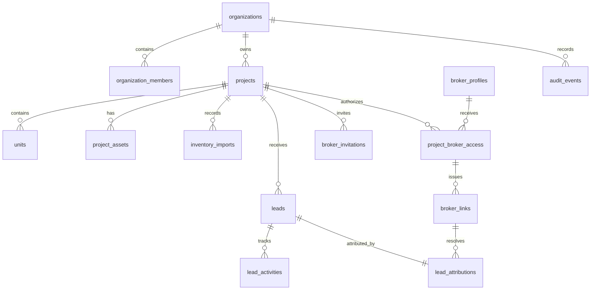

# Promoven Connect — modelo de dados e contratos (PC-00)

Estado: desenho lógico, sem migração aplicada. Criar exclusivamente em `infra/promoven-connect/supabase/` após autorização de PC-01. Não copiar tabelas ou seed de `supabase/` (Escobar) nem `infra/promoven-leads/` (contato comercial).

## Modelo proposto

| Entidade | Campos essenciais e restrições |
| --- | --- |
| `organizations` | `id uuid`, nome, slug único, status, versão, timestamps. |
| `organization_members` | PK (`organization_id`,`user_id`), papel interno, `active`, versão; Auth UID pertence ao projeto Connect. |
| `broker_profiles` | `user_id` PK, nome, CRECI número/UF, contato profissional, status de verificação e timestamps. Perfil não concede projeto. |
| `projects` | `id`, `organization_id` FK, `slug`, `public_slug` único se essa rota for adotada, estado `draft/published/archived`, flags de publicação, versão e timestamps. |
| `units` | `id`, `organization_id`, `project_id`, `code`, status, preço `numeric(14,2)` em BRL, atributos comerciais, `published`, `version`; `unique(project_id,code)` e FK composta que assegure o mesmo tenant. `organization_id` é derivado/verificado no servidor, nunca aceito como mudança de cliente. |
| `project_assets` | projeto, classe, storage path, visibilidade `public/private`, estado de publicação, MIME, hash e versão. Nenhuma URL permanente privada. |
| `inventory_imports` | projeto/organização, ator, hash do arquivo, modo, estado, totais, diff validado, operação idempotente, expiração; linhas de erro em tabela filha se necessário. |
| `project_broker_access` | `id`, organização/projeto, `broker_user_id`, estado `invited/active/suspended/revoked`, versão, instantes, responsável e motivo; unicidade de vínculo atual por (projeto, corretor). |
| `broker_invitations` | projeto, corretor/email normalizado, token **hash** único, estado, expiração curta, aceite único, ator e operação idempotente; vínculo com autorização. Token claro existe só no momento de envio. |
| `broker_links` | projeto, unidade opcional, autorização, token **hash** único, estado/revogação, expiração opcional, creator e timestamps. Opaque token com entropia alta; URL não contém broker UID. |
| `leads` | organização/projeto, unidade opcional, nome/contato de comprador, mensagem, status, versão do aviso, criado em; dado pessoal restrito. |
| `lead_attributions` | `lead_id` único, `broker_user_id` e `project_broker_access_id` históricos, `broker_link_id`, estado de autorização observado no aceite, timestamp. Não reatribuir retroativamente por revogação. |
| `lead_activities` | lead, autor, tipo, nota opcional, timestamp; append-only para histórico, com correção por evento. |
| `audit_events` | tenant/projeto, ator, ação, recurso, valores redigidos, operação idempotente, timestamp; somente servidor/RPC insere. |

Todos os IDs são UUID, salvo contador de linha de erro. Timestamps são `timestamptz`. Valores monetários permanecem exatos no PostgreSQL e são serializados como string decimal no JSON para evitar arredondamento de `number` em JavaScript. Nenhum campo de tenant ou corretor de atribuição é gravável por cliente genérico.

## Integridade e transações

- `projects(organization_id,id)` e `units(organization_id,project_id)` usam chave/constraint composta ou trigger transacional para impedir projeto e organização divergentes. A mesma regra vale para links, convite, lead e asset.
- `unique(project_id,code)` considera código normalizado; decidir regra de caixa/acentos e migração antes de importar. Versão otimista incrementa em toda alteração de preço, disponibilidade ou publicação.
- Confirmação CSV valida hash/diff e versões esperadas dentro da mesma transação; conflito aborta lote inteiro. Registrar auditoria no commit, nunca antes dele.
- Aceite de convite exige `auth.uid()`, e-mail verificado correspondente, token não vencido, bloqueio de linha e transição única para ativo; tentativa repetida retorna conflito/resultado idempotente sem criar autorização duplicada.
- Envio de lead resolve token e autorização ativa dentro da transação; grava lead, atribuição e chave de idempotência conjuntamente. Se acesso foi revogado antes do commit, a submissão atribuída falha. Política comercial para link revogado deve mostrar projeto público sem atribuição ou erro específico, nunca atribuir a outro corretor.
- Revogação atualiza autorização, invalida todos os links ativos e escreve evento de auditoria na mesma transação. Lead histórico fica intacto.
- Remoção de dados pessoais ocorre por fluxo auditado de retenção, não por cascade acidental a partir de projeto/corretor.

## Contrato HTTP proposto

Prefixo sugerido `/api/connect/v1`; usar funções Edge ou backend equivalente para toda mutação privilegiada. Tipos e validação ficam em `packages/connect-contracts`. `Authorization: Bearer <JWT Connect>` em rotas privadas; identidade vem do token validado no servidor. `Idempotency-Key` é obrigatório em convites, importações e leads. Resposta comum: `{ data, meta? }` ou `{ error: { code, message, fieldErrors?, requestId } }`. Listas aceitam `cursor` e `limit` limitado; `409` para versão/token/estado conflitante, `403` para proibido, `404` para recurso inexistente ou inacessível sem enumeração, `422` para validação e `429` para limite.

| Recurso | Contratos tipados principais | Autorização |
| --- | --- | --- |
| Organizações | `GET /organizations -> Page<OrganizationSummary>`; `PATCH /organizations/:id {expectedVersion,name,...}` | membro gestor da organização. |
| Projetos | `GET /projects?organizationId&cursor`; `POST /projects {organizationId,name,slug}`; `PATCH /projects/:id {expectedVersion,...}`; `POST /projects/:id/publish {expectedVersion}` | gestor interno. |
| Unidades | `GET /projects/:id/units?cursor&limit&status`; `PATCH /units/:id {expectedVersion,priceBRL?:DecimalString,status?:UnitStatus,...}` | leitura membro/corretor ativo conforme projeção; escrita gestor. |
| Importações | `POST /projects/:id/imports/preview {mode,rows,operationId}`; `POST /imports/:id/confirm {expectedHash,operationId}`; `GET /imports/:id` | gestor interno; transação única na confirmação. |
| Perfil de corretor | `GET/PATCH /broker/profile {creciNumber,creciState,...}` | titular autenticado. |
| Convites | `POST /projects/:id/broker-invitations {email,operationId}`; `POST /invitations/accept {token}` | gestor cria; identidade convidada aceita. |
| Autorizações | `GET /projects/:id/brokers`; `POST /broker-access/:id/suspend|revoke {expectedVersion,reason}` | gestor interno. |
| Links | `POST /broker/projects/:id/links {unitId?,operationId}`; `GET /broker/links`; `POST /broker/links/:id/revoke` | corretor com autorização ativa; servidor fixa broker e projeto. |
| Público | `GET /public/projects/:publicSlug`; `GET /public/projects/:publicSlug/units/:code`; `GET /public/share/:token` | projeção publicada; rate limit e cache correto. |
| Leads | `POST /public/inquiries {shareToken,unitCode?,buyer,privacyNoticeVersion}`; `GET /leads?projectId&cursor`; `PATCH /leads/:id {expectedVersion,status}` | submissão pública no servidor; leitura/escrita por gestor ou corretor titular conforme matriz. |
| Atividades | `POST /leads/:id/activities {type,note,operationId}`; `GET /leads/:id/activities` | participante autorizado; append-only. |
| Analytics | `GET /analytics?organizationId&from&to`, `GET /broker/analytics?from&to` | agregados restritos ao escopo. |

Exemplo de lead: `POST /public/inquiries` recebe `{shareToken,buyer:{name,contactChannel,contactValue},unitCode,privacyNoticeVersion}`. A resposta devolve apenas `{receiptId,status:"accepted"}`; nenhum `brokerId`, dados do corretor ou lead completo. O servidor ignora qualquer `brokerId` extra com validação estrita e usa o vínculo do token.

## Migração do legado

Não há migração de dados automática no MVP. Para um piloto, importar inventário aprovado por CSV de uma fonte autorizada, com revisão humana e rastreabilidade. A base Connect começa vazia e com usuários próprios. Reuso de GLB ocorre por asset aprovado e manifesto de publicação, não por leitura direta das tabelas Escobar.
