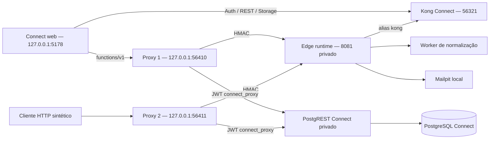

# PC-07B.3A — Proxy integrado ao Supabase Connect local

Data: 23/10/2026. Base: `master`, `a42e5879e91ce617db9d5c910562429d93d2badf`.

**Integração local implementada e comprovada contra as Edge Functions reais.** Este checkpoint não autoriza staging remoto, produção ou dados reais. O registro anterior `PROMOVEN_CONNECT_AUTONOMOUS_RUN.md` permanece como histórico: sua limitação de proxy sintético foi resolvida aqui para o ambiente local.

## Arquitetura em execução



- `connect_proxy_front_local`: bridge de entrada, somente as duas instâncias do proxy. Portas publicadas exclusivamente em loopback, 56410 e 56411.
- `connect_edge_private_local`: rede Docker `Internal=true`. Edge tem **somente essa rede e nenhuma porta publicada**. Proxies, Kong, PostgREST, Mailpit e worker são participantes confiáveis para atender as dependências existentes.
- Edge removido de `supabase_network_promoven_connect_local`. Os demais serviços preservam sua rede anterior.
- Serviço `functions-v1` removido da configuração declarativa do Kong Connect. Chamada direta a `56321/functions/v1/public-interest` retorna **403** na configuração local vigente. Os serviços Auth, REST e Storage foram preservados.
- Alias privado `kong` mantido: o runtime fornecido pelo CLI usa `SUPABASE_URL=http://kong:8000`.
- O cliente Supabase web reescreve **somente** `/functions/v1/` para `VITE_CONNECT_FUNCTIONS_URL`. Auth PKCE, persistência/renovação de sessão, REST/RLS e Storage mantêm o cliente e endereço existentes. Configuração ausente do proxy falha explicitamente; não há fallback direto.
- Imagem Node fixada por digest; proxies como usuário `node`, filesystem somente leitura, sem capabilities, `no-new-privileges`, 128 MiB, 0,5 CPU e limite de processos. Runtime Edge existente e volume de cache Deno preservados.

## Proteção das requisições

O proxy aceita somente POST nos quatro caminhos conhecidos, com origem CORS exata. OPTIONS é respondido no proxy. Remove headers internos, forwarding, `sb-api-key` e request ID externos por uma allowlist; preserva Authorization, apikey, content-type, idempotency-key e origin. O IP vem da conexão TCP, nunca de X-Forwarded-For/X-Real-IP.

Contrato HMAC-SHA256 existente reutilizado, sobre:

```text
timestamp + "\n" + client + "\n" + method + "\n" + backendPath + "\n" + sha256(body)
```

O caminho assinado é o encaminhado ao runtime, por exemplo `/public-interest`; o prefixo público `/functions/v1` é removido antes da assinatura. Os bytes do corpo, inclusive multipart, são encaminhados sem transformação. Janela de timestamp: ±60 segundos. Corpo limitado a 5.300.000 bytes no proxy e ao limite específico de cada função; resposta limitada a 6 MB. Deadline do corpo: 5 s; upstream: 6,5 s; limitador: 2,5 s.

`operationalHandler` agora exige HMAC para operações também em modo local: segredo ausente → 503; assinatura inválida → 403. `x-connect-verified-client` externo é descartado e substituído pelo valor verificado. A exceção OPTIONS não executa operação comercial. O gate de entrega local continua ativo.

O runtime local usa `--no-verify-jwt`, necessário às funções públicas e já compatível com o desenho das funções: as operações privadas continuam validando o JWT do usuário por `auth.getUser()` e aplicando RLS/RPC. HMAC autentica o transporte confiável; não concede permissão de usuário. O proxy não recebe service_role.

## Rate limit compartilhado

Migração local aplicada: `20261023133000_proxy_rate.sql`.

- Role `connect_proxy`, NOLOGIN, associada a `authenticator`; JWT próprio com validade local de 24 h.
- Única operação concedida: `public.connect_proxy_rate(text)`; acesso a leads, Auth, Storage e tabela de contadores negado nos testes.
- Estado em `private.connect_proxy_buckets`, RLS habilitada; função SECURITY DEFINER com search_path vazio.
- UPSERT atômico: 30 requisições por 60 segundos, por HMAC de IP + caminho; incrementos concorrentes serializados pelo PostgreSQL. Contador satura em 31 e entradas com mais de uma hora são removidas.
- Mesma chave e banco nas duas instâncias; restart não apaga quota. Erro de transporte/JWT/DB bloqueia com 503, sem fallback em memória.
- O limitador de captação já existente (30/hora), idempotência, RLS e auditoria de leads permanecem ativos.
- O modo Unix socket/contador em memória permanece apenas para o teste de contrato anterior; upstream HTTP exige o adaptador compartilhado.

## Endpoints reais exercitados

| Endpoint público no proxy | Evidência da Edge real |
| --- | --- |
| `/functions/v1/public-interest` | 202; lead sintético persistido, duas instâncias/repetição idempotente com apenas uma linha; captação via navegador e CRM. |
| `/functions/v1/broker-invite` | 200; convite entregue ao Mailpit, aceite, perfil, revisão e revogação no E2E. |
| `/functions/v1/broker-link` | 201; criação de links e uso no catálogo; validação negativa 400 e HMAC inválido 403. |
| `/functions/v1/asset-media` | 201 upload normalizado; 200 URLs privadas/públicas e download real do Storage; 422 imagem inválida. |

A fixture HTTP usa organização/projeto `pc07b3a-http-synthetic` e contatos `@example.invalid`. Seus leads/auditoria são preservados; não se desabilitaram guards de exclusão. A carga concorrente usa o honeypot da **Edge real** para evitar dezenas de gravações. A prova separada de persistência atravessa Edge → Kong → PostgREST → PostgreSQL, além do fluxo E2E completo.

## Resultados HTTP e segurança

Execução HTTP final registrada em `proxy/.local/http-evidence.json`, de **19:28:20 a 19:28:32 UTC** em 23/10/2026:

| Caso | Resultado |
| --- | --- |
| Requisição pública válida / função real | 202 |
| Captação efetiva + repetição na outra instância | 202 / 202; uma linha; mesmo recibo |
| Headers internos e IP falsificados enviados ao proxy | 202; descartados; mesmo contador do peer real |
| Bypass pelo Kong público | 403 |
| Bypass TCP da rede de entrada para IP privado da Edge | conexão bloqueada por rede |
| Chamada sem assinatura dentro da rede confiável | 403 |
| Header verified-client falso / assinatura inválida | 403 / 403 |
| Corpo alterado / método alterado / caminho alterado | 403 / 403 / 403 |
| Timestamp expirado / futuro além da janela | 403 / 403 |
| CORS inválido / preflight permitido | 403 / 204 |
| 40 POSTs concorrentes divididos entre duas instâncias | 30 × 202; 10 × 429 |
| Restart da primeira instância com quota esgotada | 429 nas duas instâncias |
| Edge pausado / recuperado | 502 / 202 |
| Limitador inacessível pela segunda instância / recuperado | 503 / 202 |
| Logs stdout **e** stderr de proxies e Edge | sem segredos, tokens/recibos ou dados pessoais sintéticos de controle |

A falha de backend foi injetada com pause/unpause **somente** no runtime Connect, usando requisição sem gravação. A falha do limitador desconectou temporariamente apenas o proxy 2 da rede privada. Ambos foram restaurados pelo runner. O teste limpa somente seu próprio bucket de quota de entrada para não afetar a próxima verificação.

## Regressões

- SQL/RLS: **297 asserções em 10 arquivos**, aprovadas; 285 anteriores + 12 do limitador.
- Helpers operacionais, compensação de mídia e contrato socket: **10 testes**, aprovados.
- Worker real de normalização: **5 testes**, aprovados.
- Contratos: **15 testes + typecheck**, aprovados.
- Web: **2 unitários**, build TypeScript/Vite e lint aprovados.
- Concorrência SQL: suspensão de acesso versus lead, suspensão versus CRM e quota de mídia por organização aprovadas.
- E2E final: **7/7 aprovados em 45,0 s**, em uma única execução após as correções: login, recuperação, organizações/perfil, convites/catálogo/links/leads/CRM, uploads, onboarding e inventário/CSV. A reexecução isolada de inventário também passou (3,3 s) antes da rodada final.
- Capturas 390/768/1440 renovadas pelos E2E em `apps/promoven-connect-web/test-results/visuals/`. Nenhum layout foi alterado neste checkpoint.
- Bundle: sem Escobar, Three.js, nomes/valores dos segredos privilegiados verificados. URLs e publishable key são configuração pública.
- `git diff --check` e compilação Python do bootstrap aprovados.

Falhas encontradas e tratadas durante implementação: inspeção Docker confundindo volume/container corrigida com `docker container inspect`; entrada host exigiu uma segunda rede bridge; timeout do corpo interferia na resposta de indisponibilidade, corrigido com timer encerrado ao terminar leitura; captura de logs passou a incluir stderr da Edge; alias `kong` corrigido após 401 nos primeiros E2E. Houve também uma falha transitória de import dinâmico Vite e uma criação de projeto não observada em uma rodada; reexecuções registradas, sem apagar fixtures ou relaxar asserts.

## Arquivos deste checkpoint

```text
apps/promoven-connect-web/.env.example
apps/promoven-connect-web/src/supabase.ts
apps/promoven-connect-web/tests/media.spec.ts
infra/promoven-connect/ops/start-proxy-local.py
infra/promoven-connect/ops/operations.test.mjs
infra/promoven-connect/proxy/
  proxy.mjs                    # transporte real + contrato socket anterior
  shared-rate.mjs              # PostgREST com role restrita
  Dockerfile, .dockerignore, .gitignore
  proxy.test.mjs               # contrato anterior preservado
  private-probe.mjs            # testes HMAC dentro da rede confiável
  real-integration.mjs         # HTTP real, rede, SQL, concorrência e falhas
infra/promoven-connect/supabase/functions/_shared/operations.mjs
infra/promoven-connect/supabase/migrations/20261023133000_proxy_rate.sql
infra/promoven-connect/supabase/tests/database/proxy_rate.test.sql
infra/promoven-connect/staging/{environment.example,secrets.md,readiness.json,validate-local.sh}
docs/PROMOVEN_CONNECT_PC07B3A_STATUS.md
```

Artefatos privados ignorados em `infra/promoven-connect/proxy/.local/`: backup/config Kong, env exclusivo do proxy, PID/log do CLI, evidências HTTP/rede/bundle e estado Git. Configs com segredos têm permissão 0600, diretório 0700; `.dockerignore` exclui esses arquivos do contexto de build. `.env.functions.local` e `.env.local` web locais foram atualizados sem inclusão em Git.

## Operação/reprodução local

Pré-requisitos: stack Connect inicializada em `infra/promoven-connect`, worker local já preparado, Docker, Python/PyYAML, Node, CLI Supabase instalado. Não executar o CLI na raiz do repositório.

```bash
export CONNECT_SUPABASE_CLI=/caminho/absoluto/para/supabase
python3 infra/promoven-connect/ops/start-proxy-local.py
node infra/promoven-connect/proxy/real-integration.mjs
"$CONNECT_SUPABASE_CLI" test db --workdir infra/promoven-connect
```

No web, usar `VITE_CONNECT_FUNCTIONS_URL=http://127.0.0.1:56410`. A segunda porta serve o ensaio de réplicas; não há balanceador configurado. `staging/validate-local.sh` inclui o ensaio real antes dos E2E e continua bloqueando release enquanto os outros gates estiverem falsos.

O bootstrap aplica somente migrações locais pendentes, mantém backup do Kong, injeta segredo no runtime do CLI, configura redes/alias, gera JWT restrito e recria somente os dois proxies. Renovar o JWT repetindo bootstrap antes de 24 h; expirado, o sistema falha fechado. Reaplicar após `supabase start/functions serve`, pois o CLI pode recriar redes/rotas. O código Edge mantém exigência de assinatura mesmo se a rota direta for recriada.

## Limitações e fronteiras

- Validado **localmente**, sem Supabase remoto, DNS, Vercel, deploy ou SMTP externo. Gate `trustedProxyIntegratedWithSupabase=true` registra somente a prova local. Autorização para staging/dados reais continua false; anonimização integral, SMTP remoto e política de privacidade continuam pendentes.
- Não protege contra administrador do host/Docker, que pode anexar containers à rede e ler segredos. Público/rede de entrada não tem esse acesso.
- Docker NAT apresenta os clientes locais com o mesmo peer de bridge; compartilham quota por caminho. Infra remota precisará de desenho explícito de identidade/origem confiável e TLS; não aceitar X-Forwarded-For arbitrário.
- Bootstrap reutilizou o cache Deno existente. Inclui aquecimento dos imports antes de isolar runtime recém-criado; instalação com cache inteiramente vazio não foi ensaiada.
- HMAC tem janela de replay de 60 s; idempotência comercial continua necessária. Testada em captação entre as duas instâncias. Não foi introduzido armazenamento global de nonces.
- Sem benchmark volumétrico/SLA, rotação automática de segredos ou teste de restart do host inteiro. Quotas/deadlines são políticas locais explícitas.
- Snapshot do Kong é específico desta stack; não reutilizá-lo após substituir o projeto/rotacionar suas chaves. Conservar backup privado adequado ao ambiente.

## Estado Git e preservação

Checkout já continha alterações PC-07B.1.1/1.2/2: worker, mídia, privacidade, recuperação, migrações e relatórios. Foram preservadas. O diff atual contém esses trabalhos e os arquivos acima; **não representa somente este checkpoint**. HEAD/branch mantidos, sem commits, staging Git, push, reset ou checkout destrutivo. Escobar, landing, Supabase de leads B2B, Blender/cenas/assets existentes não foram modificados.

## Rollback

1. Para indisponibilizar apenas operações Edge, parar `connect-proxy-local-1` e `connect-proxy-local-2`. Manter a rota direta bloqueada e HMAC obrigatório. Auth/REST/Storage continuam operacionais.
2. Reverter somente as mudanças deste checkpoint em uma revisão seletiva, preservando alterações anteriores. Usar uma versão de proxy/Edge compatível com HMAC; o baseline sintético não é fallback operacional seguro.
3. A migração é aditiva: deixar role/tabela/função inativas durante rollback evita apagar estado/auditoria. Não executar `db reset`, restaurar dump sobre o banco ou remover outros containers/redes.
4. O backup `proxy/.local/kong.before.yml` permite recuperação controlada do Kong. **Não restaurar acesso direto às funções para contornar HMAC.** Se for necessário reconstruir a stack, manter as funções indisponíveis até reaplicar o bootstrap e passar o ensaio HTTP.
5. Para retomar, repetir bootstrap, validar Auth/Storage e executar `real-integration.mjs`. Os testes sempre desfazem pause/desconexão em `finally`.

Contêineres Connect Edge, worker e os dois proxies ficaram ativos para desenvolvimento local. Nenhum container de prova permaneceu. Nenhuma publicação ou ação remota foi realizada.
