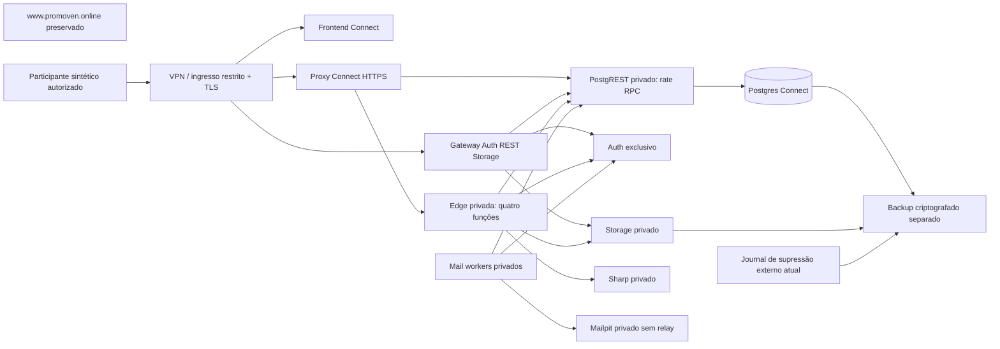

# Promoven Connect — arquitetura remota PC-07C.1

23/10/2026. **Decisão proposta, sem infraestrutura remota criada.** Produto independente do ecossistema Promoven. `www.promoven.online`, Escobar e leads comerciais continuam fora desta topologia. Evidência local não demonstra conectividade, capacidade ou segurança remota.

## Decisão e alternativas

**Recomendação para a demonstração fechada:** stack Supabase self-hosted exclusivo Connect em VM Linux, frontend estático no mesmo ambiente ou Vercel Pro separado, ingresso permitido somente a participantes autenticados por VPN/controle de acesso. Uma VM de 4 vCPU/8 GiB é hipótese inicial a medir; não é SLA nem sizing de produção. O [Docker self-hosted oficial](https://supabase.com/docs/guides/self-hosting/docker) permite controlar o gateway e os serviços. Pin de imagens/digests, volumes, firewall e versões exige um manifesto revisado em PC-07C.2; o bootstrap Supabase CLI local **não é instalador de produção**.

| Alternativa | Compatibilidade do proxy | Operação / limite | Decisão |
| --- | --- | --- | --- |
| Supabase self-hosted + rede privada + proxy próprio | Pode preservar Edge sem IP/porta pública e sem rota de bypass no Kong; comprovado apenas localmente | Responsabilidade própria por patches, DB, Auth, Storage, TLS e backups; VM única é ponto de falha | Recomendada para staging fechado; BLOCKED até adaptação/ensaio remoto autorizado |
| Supabase Cloud DB/Auth/Storage + Edge gerenciada | HMAC pode recusar requisições, mas endpoint continua alcançável pela Internet; não comprova isolamento de rede obrigatório | Não há controle do Kong/rede interna como no CLI | BLOCKED para o requisito atual |
| Supabase Cloud DB/Auth/Storage + runtime Edge/API próprio privado | Viável em princípio se as quatro funções protegidas existirem **somente** no runtime controlado; gateway público gerenciado não hospeda cópia delas | Adaptar runtime/JWT/Storage URLs, egress TLS e roles RPC; custo de VM adicional; novo ensaio obrigatório | Alternativa, NOT RUN; não trocar código automaticamente |

As [Network Restrictions gerenciadas](https://supabase.com/docs/guides/platform/network-restrictions) cobrem Postgres/pooler e não as APIs HTTPS de Auth/Storage/PostgREST. Portanto, uma allowlist de IP do banco não prova bloqueio da Edge. Isso é uma conclusão sobre os recursos documentados; eventual oferta contratada diferente exige confirmação do fornecedor. O [runtime self-hosted de funções](https://supabase.com/docs/guides/self-hosting/self-hosted-functions) permite URLs internas e controle de implantação próprio.

## Topologia executável a preparar em PC-07C.2

A seta do journal representa custódia/backup independente e versionado; **nunca restaurar uma versão antiga por cima do journal atual**. O head e a chave de âncora ficam fora do snapshot do banco. Proteção remota contra rollback do host/WORM continua pendente.

Rede proposta: `ingress` somente para gateway público e proxy; `connect_internal` interna para Edge, PostgREST, DB e workers; saída dedicada somente para serviços que realmente precisem dela. Não publicar DB, Studio, Mailpit, Sharp, mail worker ou Edge. Gateway permite somente Auth/REST/Storage necessários e recusa `/functions/v1/*`; proxy permite os quatro nomes exatos. Firewall de host e regras Docker precisam ensaio externo e por outra rede: `internal: true` isoladamente não substitui controle do host. Somente o proxy acessa o runtime protegido; o host administrador permanece parte da fronteira de confiança.

No staging, aplicar restrição de acesso também a Auth/REST/Storage/proxy e a todas as rotas públicas `/p/*` e `/s/*`. CORS não é autenticação e a URL secreta de um link não é controle de participantes. Desabilitar signup, impedir credenciais reais e manter Mailpit sem relay/saída SMTP. A captação continua testável apenas por participantes sintéticos, com aviso visível e acesso restrito; não lançar página pública de coleta.

## Contrato real do proxy e diferenças remotas

| Aspecto | Evidência local / contrato | Exigência remota pendente |
| --- | --- | --- |
| Rotas | `POST /functions/v1/{public-interest,broker-invite,broker-link,asset-media}`, OPTIONS; nomes exatos, sem query | Mesmo allowlist; sem réplica pública das funções no gateway/Cloud |
| HMAC | `timestamp\nclient\nmethod\npathname\nsha256(body)`; pathname encaminhado `/nome`; janela 60 s; cabeçalhos internos externos removidos | Segredo aleatório exclusivo ambiente; relógios NTP e teste de skew, corpo/método/caminho alterados |
| Origem | `req.socket.remoteAddress`, nunca X-Forwarded-For/X-Real-IP; allowlist de headers | **Proxy atual é HTTP.** Implementar TLS no próprio proxy (Node HTTPS com certificado montado read-only) para preservar peer, ou protocolo autenticado entre ingress e proxy com allowlist de peers. Não confiar em XFF livre. TLS terminado num reverse proxy comum agrupa clientes no mesmo peer; não alegar rate por cliente nesse desenho |
| Rate | Postgres compartilhado, role `connect_proxy` somente RPC; 30/min por cliente/caminho; captação tem limite de negócio adicional 30/h | Duas réplicas devem usar mesmo segredo de identificação/rate e DB; medir concorrência; falha de limiter retorna 503, sem fallback |
| Timeouts | Corpo 5 s, upstream absoluto 6,5 s, headers 5 s, request 10 s, teto corpo 5,3 MB; respostas limitadas | TLS, ingress e Sharp precisam limites coerentes; testar lentidão/DNS/5xx sob rede real |
| Segredos | Uma chave HMAC ativa; sem key-id/overlap no runtime atual | Rotação **com manutenção**: fechar ingresso, drenar, atualizar Edge e proxies simultaneamente, limpar/rever janela de rate, testar, reabrir; rollback coordenado. Zero downtime exige implementar keyring/kid antes |
| Replay | HMAC vincula conteúdo e janela temporal; não fornece nonce global | Idempotência de domínio e rate mitigam retries. Se exigida prevenção absoluta de replay, implementar nonce compartilhado; não está comprovada |
| Falha fechada | HMAC inválido, timestamp, CORS, rate e backend indisponível são exercitados localmente | Repetir por HTTP externo e tentativa de bypass antes de abrir acesso |

O código de todas as quatro Edge Functions, mail worker e executor de privacidade conserva travas **local-only**. `CONNECT_DELIVERY_MODE=disabled` e `CONNECT_MAIL_MODE=disabled` no template remoto são intencionais. PC-07C.2 deve introduzir modo explícito `staging-synthetic`, com participantes allowlisted e sem SMTP externo, mais bootstrap de runtime próprio; **não configurar `local` num servidor remoto**. Não houve alteração dessas travas neste checkpoint.

## Inventário de infraestrutura

READY significa preparo/evidência **local**; não significa recurso remoto existente. Recursos são estimativas iniciais dentro de VM 8 GiB; limites devem ser medidos.

| Componente | Execução / configuração / dependências | Segredo e recursos estimados | Observabilidade / rollback | Estado remoto e alternativa |
| --- | --- | --- | --- | --- |
| React/Vite | Static host próprio ou projeto Vercel exclusivo; root app e acesso ao pacote contracts; SPA fallback | Só quatro VITE públicas; build Node compatível, ~0,5–1 GiB RAM de build | HTTP/console/CSP; reativar artifact anterior compatível | BLOCKED: host/CSP/controle de demo; alternativa static VM |
| Auth | GoTrue exclusivo, URL externa exata, PKCE, signup fechado; DB/SMTP privado | JWT/service admin próprios, 256–512 MiB | Login/reset HTTP sintético, erros agregados; imagem compatível e config anterior | READY local / UNKNOWN remoto; Cloud isolado na alternativa |
| Postgres | 17 compatível com baseline local, volume próprio; 34 migrações | postgres só operação, roles anon/authenticated/service/worker; 2–4 GiB | conexões, locks, disco, backup; compensação ou restore isolado | READY local / UNKNOWN remoto; Cloud dedicado possível |
| PostgREST | Schema público/RPC com RLS, private nunca exposto como schema API | Authenticator/JWT restritos; 128–256 MiB | latência/erros; imagem/config anterior sem restaurar grants inseguros | READY local / UNKNOWN remoto |
| Storage | Buckets Connect privados, normalizados; URLs assinadas curtas; volume ou S3 isolado | service key só backend, credencial objeto exclusiva; 256–512 MiB + espaço | upload/download/checksum/quota; DB+objetos coerentes | READY local / UNKNOWN remoto |
| Edge | Runtime privado com quatro funções, Auth/RPC/Storage internos | service role, HMAC, public mail key; 256–512 MiB | requestId/status/duração somente; image anterior compatível | BLOCKED: modo remoto e URLs internas/externas |
| Proxy | Ingresso HTTPS exclusivo, peer confiável, allowlist, rede Edge | HMAC/rate JWT restrito; 128 MiB por réplica | 403/429/502/503 e latência sem URLs/token; fechar ingresso e reverter ambos pares | BLOCKED: TLS/ingresso; VM/container controlado |
| Rate compartilhado | Postgres privado via RPC, duas réplicas | role connect_proxy; pequeno estado com expurgo por política | 429/503/backlog; manter dados ao reiniciar | READY local / BLOCKED remoto |
| Sharp | Worker privado read-only, limites de corpo/CPU/memória, sem bucket público | CONNECT_WORKER_SECRET; ~192 MiB, 1 job/processo | 422/429/timeout/hash, sem imagem em log; imagem anterior | READY local / UNKNOWN capacidade remota |
| Mail workers | Dois processos, RPC restrita, leases/outbox persistente | Keyring privado fora Edge/DB, worker JWT, Auth admin; 192 MiB/0,5 CPU cada | estado/lease/tentativas, ambiguidade manual; parar/reconciliar sem reenvio cego | BLOCKED: local-only; staging Mailpit isolado |
| SMTP | Staging Mailpit privado sem relay; produção fornecedor verificado separado de SMTP Auth | Sem credencial externa em staging; produção TLS/credenciais/domínio | entrega/bounce/reconciliação; suspender dispatch | BLOCKED produção; Mailpit READY local |
| Segredos | Cofre/arquivos montados 0600, sem VITE privilegiada, sem chave em imagem/log | HMAC, service JWT, worker JWT, mail keys, ledger keys separados | acesso/expiração/rotação; manutenção coordenada | UNKNOWN cofre/operador remoto |
| Logs/métricas | Coletor próprio ou serviço isolado, payloads/URLs de token excluídos | Token ingest server-only, reserva 256–512 MiB | alertas 5xx/latência/filas/disco/cópia vencida; config anterior | READY sanitização local / BLOCKED alertas remotos |
| Backup/restore | DB+objetos+keyring; journal externo atual, snapshot consistente sem escritores | Criptografia/chaves/conta separada; orçamento 10–100 GB+retenção | checksum/idade/restore HTTP e supressões; nunca recuperar PII suprimida | READY ensaio local / BLOCKED remoto/WORM |
| DNS/TLS | Staging host separado a escolher; futuro connect.promoven.online; www intocado | ACME/DNS com escopo mínimo, certificados automáticos | validade/renovação e probe externo; restaurar só registro Connect | UNKNOWN DNS/contas; nenhuma alteração |

## Matriz de ambientes

| Contrato | Local | Staging sintético | Produção futura |
| --- | --- | --- | --- |
| ID/alvo | `promoven_connect_local`, portas fixas 56321/56322/56410 | `connect-<staging-id>` ainda não escolhido; approvedTargets vazio | ID separado, ainda não escolhido |
| Frontend | http://127.0.0.1:5178 | HTTPS host fixo, participantes restritos | futuro https://connect.promoven.online |
| API/Auth/Storage | Connect local exclusivo | VM/projeto exclusivo, sem restore de dados reais | Instância/projeto diferente do staging |
| Redirects Auth | URLs locais existentes em config.toml | host exato `/reset-password`, rotas reais `/invite/:id`/callback auditadas; sem previews wildcard | somente host produção e caminhos necessários |
| Variáveis públicas | VITE_CONNECT_ENV, SUPABASE_URL, SUPABASE_PUBLISHABLE_KEY, FUNCTIONS_URL | quatro nomes completos `VITE_CONNECT_*`, próprios; arquivo revisado sem segredo | próprios; nenhum valor reaproveitado de staging |
| Delivery / mail | local / local, Mailpit | disabled até implementação e aprovação do modo sintético; Mailpit sem relay | disabled até SMTP TLS e demais gates de produção |
| Credenciais | ignoradas, sintéticas | novas por serviço; nunca copiar arquivos locais | novas, com custódia/rotação próprias |
| Storage | connect-media-private e connect-privacy-private privados | buckets privados exclusivos + backup objetos separado | isolados do staging, retenção aprovada |
| Logs | allowlist, artefatos ignorados | sem PII/token, retenção curta proposta 7 dias | prazo aprovado por categoria, acesso auditado |
| Backup | ensaio manual local | diário criptografado, janela proposta 7 dias, restore antes da demo | RPO/RTO aprovados; retenção/ledger remoto definidos |

RPO 24 h / RTO 4 h são objetivos propostos, não medidos remotamente. DNS, cofre, domínio de e-mail, fornecedor, operador e orçamento aguardam decisão. `staging/environment.example` é inventário de variáveis, não um manifesto que pode ser publicado.

## Rollback e aceite futuro

Fechar ingresso e parar escritores/dispatch; preservar DB/Storage/outbox/journal. Frontend/proxy/runtime: voltar a imagens por digest compatíveis com o schema; nunca remover HMAC ou reabrir rota Kong. Schema: compensação revisada, não down destrutivo automático. Restore: clone isolado, banco+objetos+keyring, journal atual e reaplicação de supressões, Auth/Storage/RLS HTTP, reconciliação de outbox; somente depois decisão humana de troca. DNS: apenas registro Connect, sem atingir `www`. VM única não fornece HA; produção precisa aceitar esse risco ou financiar arquitetura adicional.
